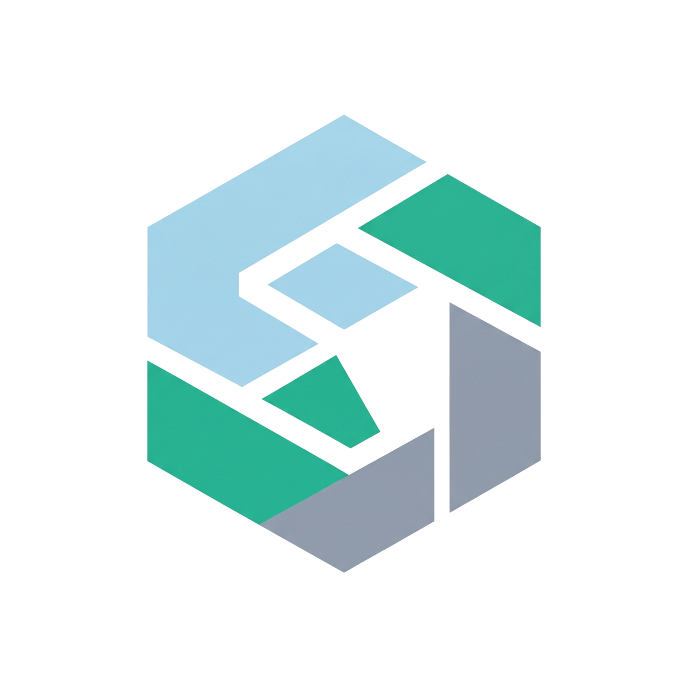

<p align="center">
  
</p>

<p align="center">
  
  
  
</p>

<p align="center">
  <strong>A native Windows capture, OCR, and desktop utility suite by ZeroNuxi under ZerroDevs.</strong>
</p>

CryoUtils keeps screenshot capture, annotation, OCR, color picking, image compression, clipboard history, and window pinning in one small tray application. Capture a region or a window, mark it up, copy or save it, pull text out of it locally, or record it as a GIF or MP4. The Cryo Workbench adds a capture library, recipes, file actions, privacy controls, color tools, PDF/media jobs, and diagnostics without a second app. It runs as a standard user, keeps its data on the machine except for explicitly consented uploads, and has no account, telemetry, or background service.

The current baseline is `0.0.102`. The application runs locally from the tray and does not require administrator elevation.

## Contents

- [At a glance](#at-a-glance)
- [Feature tour](#feature-tour)
- [Capture and annotations](#capture-and-annotations)
- [Windows Explorer context menus](#windows-explorer-context-menus)
- [OCR](#ocr)
- [Color picker](#color-picker)
- [Image compressor](#image-compressor)
- [Cryo Workbench](#cryo-workbench)
- [Workspace tools and Activity Center](#workspace-tools-and-activity-center)
- [Clipboard history](#clipboard-history)
- [Window pinner](#window-pinner)
- [Tray, startup, and appearance](#tray-startup-and-appearance)
- [Updates](#updates)
- [Install and run](#install-and-run)
- [Build from source](#build-from-source)
- [Versioning and releases](#versioning-and-releases)
- [Testing and diagnostics](#testing-and-diagnostics)
- [Data, privacy, and local files](#data-privacy-and-local-files)
- [Architecture](#architecture)
- [Project layout](#project-layout)
- [Limitations](#limitations)
- [Troubleshooting](#troubleshooting)
- [Security policy](#security-policy)
- [Contributing](#contributing)
- [License and attribution](#license-and-attribution)

## At a glance

| Item | Details |
| --- | --- |
| Platform | Windows 10 version 2004 (build 19041) or Windows 11, x64 |
| Runtime | .NET 10 with pure WPF (zero WinForms / SkiaSharp / Windows.SDK.NET) |
| Privileges | Standard user (`asInvoker`); no UAC and no service |
| Capture | Multi-monitor freeze frame, region or window selection, `1–0` tool shortcuts, draggable annotation handles |
| Recording | Region GIF & native WGC/D3D11/Media Foundation MP4, WASAPI system audio + mic pickers, webcam bubble, cursor/click effects, trim editor, and disk-backed Instant Replay (`Ctrl+Shift+R`) |
| Shell integration | Opt-in per-user Windows Explorer `CryoUtils` and `CryoUtils Convert` right-click menus for images, GIFs, PDFs, videos, audio, JSON/XML/text, all files, and folders |
| Output | PNG, JPG, WebP, ICO, GIF, MP4, MP3, WAV, M4A, PDF |
| OCR & QR | Local Windows OCR (editable results, code mode, color swatches) and offline ZXing QR scan/generate |
| Tools | Cryo Workbench (library, recipes, privacy, files, colors, PDF/media, logs), Activity Center, Live Draw, Screen Ruler, File Shelf, Image Editor, Developer Toolbox, color picker, compressor, clipboard history, window pinner |
| Appearance | Dark (default), Light, or System; English and Arabic with RTL |
| Storage | `%APPDATA%\CryoUtils\settings.json` plus saved and auto-archived captures |
| Network use | GitHub Releases update checks/downloads, plus explicitly consented uploads to catbox.moe; an optional local-folder provider uses no network |
| Installer | Per-user Inno Setup installer; no elevation |
| License | Apache License 2.0 |

## Feature tour

### Dashboard

The dashboard is a compact, resizable CryoTray-style WPF window (`680×700`, `Ctrl+K` quick command search) with six tabs: **Overview**, **Capture**, **Tools**, **Workspace** (unified 8-section Cryo Workbench for Library, Workflows, Privacy, File Actions, Color, Media, Pinner, and Diagnostics), **Hotkeys**, and **Settings** (with About and Updates integrated).

The dashboard uses the shared CryoTray visual grammar: edge-to-edge PCB Hero header, glowing Aperture mode strip, `48×24` `ON`/`OFF` pill switches, flat `1 px` divider rows, `#141414` dark surface (`WindowBorderBrush` `#2B88D8`), and small sharp radii (`CornerRadius="0"`). It switches theme and EN/AR RTL layout live at runtime.

### Capture and annotations

The capture hotkey is configurable and defaults to `PrintScreen`. If Windows already owns that key, the dashboard suggests `Ctrl+Shift+S`. A standalone `HOME` key is also accepted by the hotkey picker.

Capture opens one overlay per monitor over a frozen desktop snapshot. The current monitor's overlay supports:

- Drag selection with a live size badge, moving, eight resize handles, and double-click window selection.
- `Ctrl+A` for the full monitor, `Enter` or `Ctrl+C` to copy and close, right-click to step back cleanly (`active stroke -> active tool -> Select -> deselect -> close`), and `Esc` to exit immediately.
- Starts cleanly in **Select** mode; press **`1`–`0`** (`1` Pen, `2` Line, `3` Arrow, `4` Rectangle, `5` Ellipse, `6` Spotlight, `7` Redaction, `8` Highlighter, `9` Text, `0` Blur), `N` (Step number), or their letter aliases (`P, L, A, R, E, S, K, H, T, B`) — clicking or pressing an active tool again toggles back to **Select**. `Text` (`9`) and `Step` (`N`) also start a region drag when no selection exists yet.
- Selected annotations display a dashed highlight and draggable handles (endpoint handles on Line/Arrow with `Shift` angle snap, 8 resize handles on Rectangle/Ellipse/Spotlight/Blur with live blur refresh, and `Delete`/`Backspace` removal).
- Color swatches, a custom color picker, and mouse-wheel thickness control.
- An optional pixel magnifier with a color readout (off by default; active before/during region drag and annotation placement, hidden over rails and freehand ink).
- The action rail automatically moves around the tool rail, so small or narrow selections do not stack the controls.
- Undo and redo.
- Copy, save, print, pin to screen, OCR, scan QR, and upload actions.
- Recording a selected region as GIF or MP4, with FPS and duration controls. MP4 now records through the Windows-native live pipeline (Windows.Graphics.Capture, Direct3D 11, Media Foundation) instead of buffering PNG frames; GIF stays on the original encoder.
- Opening **Recorder settings** from the Capture card or Tools tab to choose MP4 resolution (Source/720p/1080p/1440p/2160p), 30 FPS or 60 FPS target, quality or a custom bitrate, duration, system audio, microphone, cursor highlight, click effects, webcam bubble, and trim-before-save.
- Pausing/resuming an MP4 recording with paused time removed from the final timestamps, then optionally trimming before saving.
- **Instant Replay**: enable a 15 second–10 minute disk-backed buffer for a chosen monitor. The replay hotkey (default `Ctrl+Shift+R`) saves the last N seconds as MP4 without re-encoding; the tray menu can start/stop the buffer or save a replay, and the tray icon shows a red badge while recording or buffering.
- Scrolling capture collects frames while the target window scrolls, detects row overlap, and saves a stitched image.
- Optional delayed capture with a countdown that restores the dashboard when canceled.

The Overview tab keeps the **Activity Center** closed by default, features a closeable **Recent captures** strip combining screenshots and recordings (`This session` or `All time`), and opens with a quick summary bar above recent files.

Saving uses a save dialog or the configured quick-save folder. The default output folder is `Pictures\CryoUtils`.

### Windows Explorer context menus

CryoUtils can optionally register per-user right-click menus (`CryoUtils` and `CryoUtils Convert`) under `HKCU\Software\Classes` without admin elevation (managed in Settings):

- **Images (`.png`, `.jpg`, `.jpeg`, `.webp`, `.bmp`, `.ico`, `.jfif`) & `.gif`:**
  - *Tools:* Resize (`50%`, `1920px`, `512px`), Quick compress, Remove background, Trim transparent margins, Strip EXIF metadata, Extract text (OCR), Scan QR code, Copy pixels to clipboard, Pin to screen, Upload & copy link.
  - *Convert:* Convert to `PNG`, `JPG`, `WebP`, `ICO`, Image to `PDF`, Flatten transparency to white, Extract GIF frames (`.gif`), Copy Base64 Data URI.
- **PDF (`.pdf`):** PDF to PNG/JPG pages, Compress PDF, Grayscale PDF, Rotate `90°` / `180°`, Upload & copy link.
- **Video (`.mp4`, `.mkv`, `.avi`, `.mov`, `.webm`):** Compress for Discord (`_compressed.mp4`), Video to GIF, Extract MP3 audio, Mute audio, Save video thumbnail, Upload & copy link.
- **Audio (`.mp3`, `.wav`, `.m4a`, `.flac`, `.ogg`, `.aac`):** Convert to `MP3`, `WAV`, `M4A`, Upload & copy link.
- **JSON, XML & Text (`.json`, `.xml`, `.txt`, `.md`, `.csv`):** Pretty-print/minify JSON, Pretty-print XML, Generate QR code (`text-to-qr`), Copy SHA-256, Upload & copy link.
- **All Files (`*`):** Upload & copy link, Copy `SHA-256`, Copy `MD5`.
- **Folders (`Directory`):** Merge folder images into PDF, Folder images to animated GIF, Batch compress folder images.

Commands execute through short-lived `CryoUtils.exe --action <action> "<path>"` helpers and show non-blocking result toasts.

### OCR

OCR uses the Windows OCR engine and the language packs already installed in Windows. The selected region is read locally; no image or text is uploaded.

The **Text from selection** window is more than a read-only preview:

- Short results use an auto-sized, top-aligned rich text editor instead of a large empty area.
- OCR line breaks are preserved; the text is editable and can be copied, opened from a text/code/Markdown file, saved as a text file, or loaded by drag/drop.
- **Code mode** switches to a monospace, syntax-colored editor with horizontal scrolling; **Wrap lines** controls wrapping for prose.
- Line and character counts are shown in the header.
- Hex, RGB/RGBA, and HSL/HSLA color codes are detected and listed as clickable swatches. Clicking a swatch copies that code.
- Markdown files open as editable source text; CryoUtils does not render formatted Markdown.

OCR availability depends on the Windows language packs. English and Arabic are detected when the corresponding OCR language is installed.

### Color picker

The color picker freezes the desktop, shows a magnifier grid, and reports the selected color as HEX, RGB, and HSL. Click a screen pixel to copy the active format, or use the per-format copy rows. Recent colors appear in the dashboard Tools tab.

The default hotkey is `Ctrl+Shift+C`. The module can be disabled from the dashboard, which unregisters its hotkey.

### Image compressor

The compressor accepts PNG, JPG/JPEG, WebP, and GIF files by drag/drop or file browser. It provides:

- Discord, WhatsApp, and custom presets.
- Quality and scale controls for custom compression.
- Before/after sizes, saved percentage, and a preview.
- Save as, copy file, and a keep-original fallback when re-encoding would be larger.

### Cryo Workbench

**Cryo Workbench** (`Tools > Cryo Workbench`, tray menu, or the configurable `Ctrl+Shift+W` hotkey) is one window with tabs for the larger jobs. Each tab reads and writes local data unless it performs an explicitly requested upload.

- **Library**: indexes saved captures in the configured save folder, records the source application and window, and supports search, tags, favorites, multi-select, open, reveal, and Recycle Bin deletion. Metadata lives in `capture-library.json`; captures are never copied into a second library folder.
- **Recipes**: post-capture recipes run after **Copy** or **Save**. A recipe can match the source application, use a filename template, optionally resize, and then save, copy, OCR to the clipboard, or upload. Workflows are stored separately in `workflows.json`.
- **Privacy**: choose Catbox or a local uploads folder, turn external uploads off, review and withdraw consent, view upload history, open or delete local uploads, and expire local uploads after a configured number of hours. Upload history and local-expiry metadata live in `upload-history.json`. Catbox has no supported remote-delete API, so the UI does not pretend to delete a Catbox file.
- **File actions**: queue image conversion, compression, or recycling with dry-run previews, independent output folders, overwrite policies, cancellation, retry, and before/after previews. Recycle always goes through the Recycle Bin and asks before a real batch. Jobs run locally and do not require an internet connection.
- **Colors**: extract palettes from a captured image or the screen, save contrast pairs, export CSS, JSON, or Tailwind tokens, and preview deuteranopia, protanopia, and tritanopia simulations. Simulation is a visual aid, not a certification.
- **Pinner**: list every pinned window, adjust opacity and click-through per window, manage an exclusion list, and attempt a best-effort restore after restart by matching the saved title and process. Restore cannot survive a title change or a process that is no longer running.
- **PDF/media**: extract, merge, split, reorder, rotate, or OCR PDF pages; trim a video; and create a GIF from a selected frame range. PDF password protection and encryption are intentionally not implemented; the UI says so instead of writing a file that looks encrypted but is not.
- **Diagnostics**: a bounded local log, unhandled-exception recording, a log viewer, and a safe mode that disables risky pinner behavior. Safe mode can also be requested at launch with `CryoUtils.exe --safe-mode`, which clears the saved pin session and restores saved topmost windows before the app starts normally.

### Workspace tools and Activity Center

The **Overview** tab includes a compact, collapsed-by-default **Activity Center** (storage/retention summary, recent uploads, workflow runs, active file jobs, pinned windows, and quick actions) above the closeable **Recent captures** strip. Refresh is manual or automatic when the underlying services change; the center does not copy or upload capture data.

The **Tools & Utilities** tab adds a **Workspace tools** card:

- **Live Draw** (`Ctrl+Shift+D` by default) opens a transparent, topmost ink layer over the whole virtual desktop without freezing the screen first. Pen, arrow, box, and text tools draw over any app; ink can fade after five seconds or stay until cleared. **Capture annotated screen** hides the overlay, captures the desktop, composites the ink, and saves a PNG through the normal capture library. Esc closes and Ctrl+Z undoes.
- **Screen Ruler** measures horizontal, vertical, diagonal, or rectangular regions in physical pixels, shows distance and angle, supports click-to-place alignment guides, and copies the current readout. It never takes a screenshot.
- **File Shelf** is a floating drop target for images, PDFs, videos, and folders. Items can be dragged back to another app, batch-compressed or converted through the existing file-action queue, merged to PDF, removed, or copied as paths.
- **Image Editor** opens an existing PNG/JPG/WebP/BMP file and supports Pen (`1`/`P`), Arrow (`2`/`A`), Box (`3`/`R`), Redact (`4`/`K`), and Text (`5`/`T`), custom color picker, stroke thickness controls & mouse-wheel adjustment (`1–24 px`), crop (`6`/`C`, `Enter` to apply, `Esc` to clear), rotate, resize, Undo/Redo (`Ctrl+Z`/`Ctrl+Y`), save-as/convert, and copy to clipboard.
- **Developer Toolbox** formats JSON and XML, Base64/URL encodes and decodes, computes SHA-256, generates GUIDs, and tests regular expressions locally.

### Clipboard history

Clipboard history is opt-in. When enabled, it records text and image clips, supports search, restores an item to the clipboard, and can remove one item or clear the list. A heuristic marks password, token, API key, and similar text as sensitive and can schedule automatic removal. Named snippets, pinned clip values, text transforms, image OCR, and URL/Base64/JSON helpers are available from the clipboard window.

Memory-only is the default. Optional **encrypted persistence** stores text clips with Windows DPAPI for the current user; images are never persisted. Persistence and per-item expiry are explicit opt-ins, and disabling the module clears the live list.

The module is disabled by default. Disabling it stops the clipboard listener and clears the in-memory list. A separate plain-text paste hotkey strips formatting and sends `Ctrl+V` to the focused application.

### Window pinner

The window pinner toggles `WS_EX_TOPMOST` on the focused window through the default `Ctrl+Win+T` hotkey or the dashboard Tools card. Multiple windows can be pinned at once. Each pinned window has independent opacity and click-through state, and the optional border tracks the most recently pinned window. An exclusion list prevents named applications from being pinned, and a best-effort restore re-pins matching windows after restart. The confirmation sound is optional.

### Tray, startup, and appearance

The tray icon is the normal entry point:

- Left-click opens the dashboard by default; it can also be configured to start capture.
- The tray menu provides capture, recording, color picker, dashboard, and exit actions.
- **Run in background** is on by default, so a normal launch starts in the tray.
- The title-bar **X** always hides the dashboard and keeps the tray process alive. Quit only from the tray's **Exit** action.
- **Run on startup** writes a per-user `HKCU\Software\Microsoft\Windows\CurrentVersion\Run` entry and passes `--background`. It is off by default.

Dark is the default appearance. Light and System modes use the same resource tokens and apply live. Arabic switches layouts to RTL while technical values and shortcuts stay LTR.

## Updates

The About tab checks the latest GitHub release for `ZerroDevs/CryoUtils`. When a newer release is available, CryoUtils downloads the release's setup executable or MSI, saves a rollback copy of the current executable when that option is enabled, and starts the per-user installer after the application exits.

The release assets include SHA-256 checksum files. Verify a downloaded installer or portable archive manually if you want a stronger integrity check before running it:

```powershell
Get-FileHash .\CryoUtils-Setup-0.0.102.exe -Algorithm SHA256
```

The in-app updater relies on HTTPS GitHub delivery; it selects the matching `Full` (`CryoUtils-Setup-<version>.exe`) or `Lite` (`CryoUtils-Setup-Lite-<version>.exe`) installer based on whether `coreclr.dll` is present. Signing is applied to release assets when the optional signing secrets are configured in GitHub Actions.

## Install and run

### Installer

Download `CryoUtils-Setup-<version>.exe` (**Offline Full**, zero extra downloads) or `CryoUtils-Setup-Lite-<version>.exe` (**Lite**, smallest download; automatically installs `.NET 10 Desktop Runtime x64` if missing) from [GitHub Releases](https://github.com/ZerroDevs/CryoUtils/releases), optionally verify its `.sha256` file, and run it.

The installer is per-user and installs to:

```text
%LOCALAPPDATA%\Programs\CryoUtils
```

It creates Start Menu and optional desktop shortcuts, compresses the installed folder silently via `compact.exe`, and does not request administrator elevation. It closes a running CryoUtils process before replacing files. Uninstalling runs `--uninstall-cleanup` and removes the application and shortcuts; `%APPDATA%\CryoUtils\settings.json` is left in place.

### Portable zip

Download `CryoUtils-<version>-win-x64.zip` (self-contained Offline Full) or `CryoUtils-Lite-<version>-win-x64.zip` (framework-dependent Lite requiring `.NET 10 Desktop Runtime x64`), verify its `.sha256` file, and extract it. Run `CryoUtils.exe` from the extracted folder (or `CryoUtils.exe --capture` for zero-idle one-shot screenshots).

The portable archive includes `VERSION`, `LICENSE`, and `NOTICE`. The in-app update path downloads the matching per-user installer rather than replacing a portable folder in place.

### Requirements

- Windows 10 version 2004 (build 19041) or newer, or Windows 11, x64.
- No administrator privileges.
- Optional: additional Windows OCR language packs for OCR in those languages.
- Internet access only for update checks, consented uploads, or Lite runtime bootstrap if `.NET 10 Desktop Runtime` is absent.

### First run

The first launch starts in the tray when **Run in background** is enabled (the default). Open the dashboard from the tray icon, or disable **Run in background** in Settings to open it on launch.

## Build from source

### Prerequisites

- Windows 10/11 x64.
- [.NET 10.0 SDK](https://dotnet.microsoft.com/download/dotnet/10.0).
- Optional, for installers: [Inno Setup 6.3 or newer](https://jrsoftware.org/isdl.php). `build-installer.ps1` can install it through winget if it is missing.

### Build

```powershell
dotnet restore CryoUtils.csproj
dotnet build CryoUtils.csproj -c Release
```

The debug executable is written to:

```text
bin\Debug\net10.0-windows\CryoUtils.exe
```

Run a local debug build directly, start it in the tray, or run a one-shot capture:

```powershell
.\bin\Debug\net10.0-windows\CryoUtils.exe
.\bin\Debug\net10.0-windows\CryoUtils.exe --background
.\bin\Debug\net10.0-windows\CryoUtils.exe --capture
```

### Build the installer and portable zip

With Inno Setup available:

```powershell
.\build-installer.ps1 -Variant All
```

The script publishes Full and Lite win-x64 builds and creates:

```text
Installer\Output\CryoUtils-Setup-<version>.exe
Installer\Output\CryoUtils-Setup-Lite-<version>.exe
release\CryoUtils-<version>-win-x64.zip
release\CryoUtils-Lite-<version>-win-x64.zip
```

Each file receives a matching `.sha256` checksum. The Inno script is `Installer\CryoUtils.iss`; it packages the publish output plus `LICENSE`, `NOTICE`, and `VERSION`.

## Versioning and releases

The root `VERSION` file contains exactly three numeric parts. `CryoUtils.csproj` reads it into the assembly, file, and informational versions.

- Current baseline: `0.0.102`.
- Next releases: `0.0.103`, `0.0.104`, and so on.
- Tags: `v0.0.102`, `v0.0.103`, and so on.

A push to `main` that changes `VERSION`, or a manual **Release** workflow run, validates the version, builds the Release application, publishes a self-contained win-x64 payload, compiles the Inno installer with Inno Setup, creates checksummed setup and portable assets, and publishes a GitHub release for the matching tag.

Signing is optional. When `WINDOWS_SIGNING_PFX_BASE64` and `WINDOWS_SIGNING_PFX_PASSWORD` repository secrets are configured, the app and installer are signed and verified; otherwise the workflow publishes unsigned assets and emits a warning.

## Testing and diagnostics

CryoUtils includes a dependency-free test runner for pure services and capture geometry (contrast math, clipboard transforms, hashing, JSON/XML formatting, unique filenames, PDF page ranges, color-vision simulation, capture-control-bar layout, palette exports, recording option normalization, replay retention/remux math, arrow geometry, tool toggling, and annotation bounds):

```powershell
dotnet run --project Tests/CryoUtils.Tests.csproj -c Release
```

Before a pull request or release, also build the app and exercise the affected interactive path manually:

```powershell
dotnet build CryoUtils.csproj -c Release
```

Useful checks include startup and tray lifetime, capture selection and copy, annotation export, OCR on an installed language pack, GIF/MP4 output, compressor formats, clipboard capture, pinned-window borders, English/Arabic switching, and theme switching.

Crash paths are written to the bounded diagnostic log and can be viewed in **Workbench > Diagnostics**; settings writes are atomic and failures do not stop the running session. Launch `CryoUtils.exe --safe-mode` when a pinned window or overlay needs recovery.

## Data, privacy, and local files

CryoUtils does not include telemetry, analytics, advertising, or accounts. It is local-first, with two explicit network paths: optional GitHub update checks/downloads and opt-in cloud uploads.

Local files:

- `%APPDATA%\CryoUtils\settings.json`: settings, window position, recent colors, and update preferences.
- `%APPDATA%\CryoUtils\capture-library.json`: capture source metadata, tags, and favorites. The capture files themselves stay in the configured save folder.
- `%APPDATA%\CryoUtils\workflows.json`: post-capture recipes.
- `%APPDATA%\CryoUtils\upload-history.json`: upload links and local-upload expiry metadata.
- `%APPDATA%\CryoUtils\clipboard.bin`: only when encrypted clipboard persistence is explicitly enabled; DPAPI-protected text, never images.
- `%APPDATA%\CryoUtils\logs\`: bounded diagnostic logs.
- `%APPDATA%\CryoUtils\uploads\`: local upload-provider files, when that provider is selected.
- `%LOCALAPPDATA%\CryoUtils\Rollback\`: optional rollback executable and version file created before an update.
- `%TEMP%\CryoUtils\update\`: downloaded updater files.
- The configured save folder, defaulting to `Pictures\CryoUtils`: images and recordings you choose to save.

Session capture thumbnails are held in memory. Clipboard history is memory-only by default; encrypted persistence is opt-in and can be disabled, which removes the persistence file. Explicit saves, quick saves, QR captures, and copies/uploads archived by the **Archive copied and uploaded selections** setting persist in the save folder.

The saved-capture limit only manages files whose names start with `CryoUtils_`; unrelated files in the same folder are never touched. Pruned captures go to the Recycle Bin, and lowering the limit asks for confirmation before anything is moved.

Update checks contact:

```text
https://api.github.com/repos/ZerroDevs/CryoUtils/releases/latest
```

The request is a standard GitHub API call and does not include screenshots, OCR text, settings, or usage data.

### Cloud uploads

Upload is never automatic. The first external upload requires an explicit consent prompt, and external uploads can be turned off completely in **Screen Capture** settings or from **Workbench > Privacy**. Accepted external uploads send the selected image or file to **catbox.moe**, a third-party public host, and return a direct link. The upload window labels the destination, and the consent prompt explains that anyone with the link can access the file. Do not upload private or sensitive content.

Choose the **local folder** provider to keep uploads on this computer. Local uploads never touch the network; they land in `%APPDATA%\CryoUtils\uploads`, appear in Privacy history, and can be deleted or expire automatically. Catbox does not expose a supported remote-delete endpoint, so a Catbox link cannot be revoked from CryoUtils.

## Architecture

CryoUtils is one WPF process with a tray lifetime and short-lived capture windows. The application root is `App.xaml.cs`; `SettingsService`, `ThemeService`, `LocalizationService`, and `GlobalHotkeyService` are the shared application services.

```text
CryoUtils.exe
├── App.xaml.cs                     startup, tray lifecycle, capture, settings, updates
├── Views/
│   ├── MainWindow                  resizable CryoTray-style dashboard (6 tabs + Ctrl+K search)
│   ├── Tabs/WorkbenchTabView       unified 8-subtab Cryo Workbench (Library..Diagnostics)
│   ├── CaptureOverlayWindow        per-monitor capture surface
│   ├── OcrResultWindow             editable OCR results and text tools
│   ├── ColorPickerWindow           magnifier and color formats
│   ├── ClipboardHistoryWindow      searchable clipboard list
│   ├── ClipboardTransformWindow    text transform preview
│   ├── RecordingBarWindow          GIF/MP4 recording controls
│   └── PinWindow / PinnedBorder    pinned images and topmost window border
├── Services/
│   ├── ScreenCaptureService        monitor enumeration and physical-pixel capture
│   ├── AnnotationRenderer          vector annotations and destructive blur
│   ├── GifEncoder / Mp4Writer      GIF89a and Media Foundation output
│   ├── OcrService                  Windows.Media.Ocr
│   ├── TextAnalysisService         code detection and color-code parsing
│   ├── CompressionService          image compression and preview
│   ├── ClipboardService            opt-in clipboard history, DPAPI persistence
│   ├── CaptureLibraryService       capture metadata, search, tags, favorites
│   ├── WorkflowService             post-capture recipes
│   ├── FileActionQueueService      dry-run file jobs with overwrite policies
│   ├── ColorStudioService          palettes, contrast pairs, exports
│   ├── UploadProviderService       Catbox or local upload provider
│   ├── DiagnosticsService          bounded logs and safe mode
│   ├── TopmostService              window pinning
│   ├── UpdaterService              GitHub release checks and restart flow
│   └── Settings / Theme / Startup  local preferences and presentation
└── Tray/TrayIconManager.cs         tray icon menu and entry points
```

Key choices:

- Capture coordinates are physical pixels; WPF device-independent units are not mixed into capture math.
- Annotations are rendered from the original frozen frame for export, not from the dimmed overlay.
- The last 10 recent captures are held in memory for the dashboard strip.
- The compressor keeps the source when an encode would be larger.
- The shared theme uses dynamic resources, so an open window updates during a live theme switch.
- Arabic mirrors layout while technical tokens remain LTR.
- Settings are written atomically through a temporary file and a move.

## Project layout

```text
CryoUtils.csproj                  .NET 10 pure WPF + Win32/WinRT project and metadata
VERSION                           release version consumed by MSBuild and the installer
LICENSE                           Apache License 2.0
NOTICE                            attribution and redistribution notice
app.manifest                      asInvoker and per-monitor DPI settings
build-installer.ps1               Full Offline and Lite publish, Inno compile, portable zip
Installer/CryoUtils.iss           per-user Inno Setup definition (Full + Lite variants)
.github/workflows/release.yml     Windows release packaging and GitHub release publication
Models/                           settings, capture tools, annotations
Services/                         capture, OCR, WIC/Media Foundation, clipboard, updates, trim
Tray/                             Win32 system tray icon and owner-drawn menu
Views/                            dashboard, lazy-loaded tabs, overlays, result and tool windows
Resources/                        XAML controls and English/Arabic dictionaries
Images/                           compressed application and tray icons
Tests/                            service and behavior verification suite
```

## Limitations

- **Windows only.** The application depends on WPF, Windows Imaging Component (WIC), Windows OCR, Windows Data PDF, Media Foundation, and Win32 APIs (zero WinForms / SkiaSharp / Microsoft.Windows.SDK.NET).
- **OCR language packs vary.** Windows OCR can only recognize languages installed for OCR; a missing pack causes a localized OCR failure.
- **PrintScreen is often reserved.** Use the suggested `Ctrl+Shift+S` fallback or another combination when registration fails.
- **Mixed-DPI capture has not been fully exercised.** The test environment uses two 1920 x 1080 monitors at 100% scaling.
- **Recorded GIF/MP4 files have not been visually played back** in this environment; the encoders were verified by file output and the replay remux path was exercised in the service harness.
- **MP4 audio needs the Windows AAC encoder and an available device.** The app falls back to a silent/video-only file and reports the condition instead of failing the recording when AAC or the device is unavailable.
- **60 FPS is a target, not a guarantee.** Fresh 10-second 1080p WGC/D3D11 runs on the reference PC measured 59.5–60.0 FPS for capture/readback and 59.6–59.7 FPS for the complete recorder in the steady 8-second window; the latest run was 477 frames / 8.00 seconds = 59.6 FPS (595 frames / 10.09 seconds including start-up). The Media Foundation H.264 encoder alone handled about 240 FPS. WGC/D3D readback, scaling, effects, display refresh, and encoder load vary by machine; check frame drops before relying on 60 FPS at high resolutions.
- **Instant Replay may start up to one segment (about 4 seconds) before the requested cutoff.** Segment boundaries are kept on keyframes so saving can remux rather than re-encode.
- **Limited automated coverage.** Pure services have a small test runner; WPF surfaces, registry integration, DPAPI, pinner restore, PDF, video, and Media Foundation still need manual verification.
- **PDF encryption is not implemented.** The PDF tab supports page work and OCR but not password protection; it says so instead of producing a misleading file.
- **Scrolling capture is best effort.** Row-overlap stitching handles ordinary scrolling, but sticky headers, parallax, and smooth-scroll animation can still produce artifacts. The control bar hides itself while a frame is taken, so it is not baked into the stitch. The stitched image is capped at 16,000 px.
- **Pinner restore is best effort.** It matches saved titles and process names; a renamed tab, closed application, or changed process will not restore.
- **Recipes are post-capture.** They run after **Copy** or **Save**, not merely after a selection is drawn, so annotation can finish before a file is produced.
- **Workbench UI is not covered by automated tests.** The Release build and service tests pass, but the Workbench tabs, clipboard persistence, pinner, PDF, and video paths were not clicked through in this environment.
- **Update integrity uses `.sha256` verification.** The in-app updater downloads the published `.sha256` asset over HTTPS and verifies the setup executable before launch; Authenticode enforcement remains optional when repository signing secrets are configured.
- **Portable updates install per-user.** A portable copy does not update its own folder in place; the update button starts the per-user setup.
- **Markdown is source text.** The OCR result window opens and edits Markdown but does not render it.
- **No fan, GPU, power, or driver control.** CryoUtils is a desktop utility, not a hardware-control tool.

## Troubleshooting

| Problem | What to check |
| --- | --- |
| Capture hotkey does nothing | If `PrintScreen` is owned by Windows, use the dashboard fallback `Ctrl+Shift+S` or choose another key in Hotkeys. |
| Only one monitor appears | Confirm Windows is extending the desktop and both monitors are active; overlays are created per active monitor. |
| OCR reports no text | Check that the selected region contains readable text and the required Windows OCR language pack is installed. |
| OCR window looks like an old fixed-height dialog | Rebuild/run the current `0.0.101` build; the current window auto-sizes to its content. |
| GIF or MP4 is empty | Keep the recording above one frame and confirm the selected region is non-zero. |
| Clipboard history is empty | Enable the clipboard module. History is memory-only unless encrypted persistence is enabled in the clipboard window. |
| Tray icon is hidden | Open the Windows notification-area overflow and enable the CryoUtils icon. |
| Dashboard does not open on launch | **Run in background** is on by default; open it from the tray or turn that setting off. |
| Update check fails | Confirm access to GitHub Releases and try the manual Release page. |
| Installer asks for elevation | Use the current per-user installer; older or unrelated packages may require elevation. |
| Arabic layout is clipped | Switch language again to reapply the resource dictionary and report the window name. |

## Security policy

Please report security problems privately through GitHub's private vulnerability reporting or by email. See [SECURITY.md](SECURITY.md) for supported versions, response expectations, and the local threat model.

## Contributing

Bug reports, localization fixes, and focused pull requests are welcome. Read [CONTRIBUTING.md](CONTRIBUTING.md) for build commands, architectural rules, localization/theme conventions, versioning, and the PR checklist.

## License and attribution

CryoUtils is licensed under the [Apache License, Version 2.0](LICENSE). See [NOTICE](NOTICE) for attribution and redistribution requirements.

Copyright 2026 ZeroNuxi - ZerroDevs.

The application was created by ZeroNuxi under the ZerroDevs organization. Redistributions and derivative works must retain the attribution notice in [NOTICE](NOTICE).
